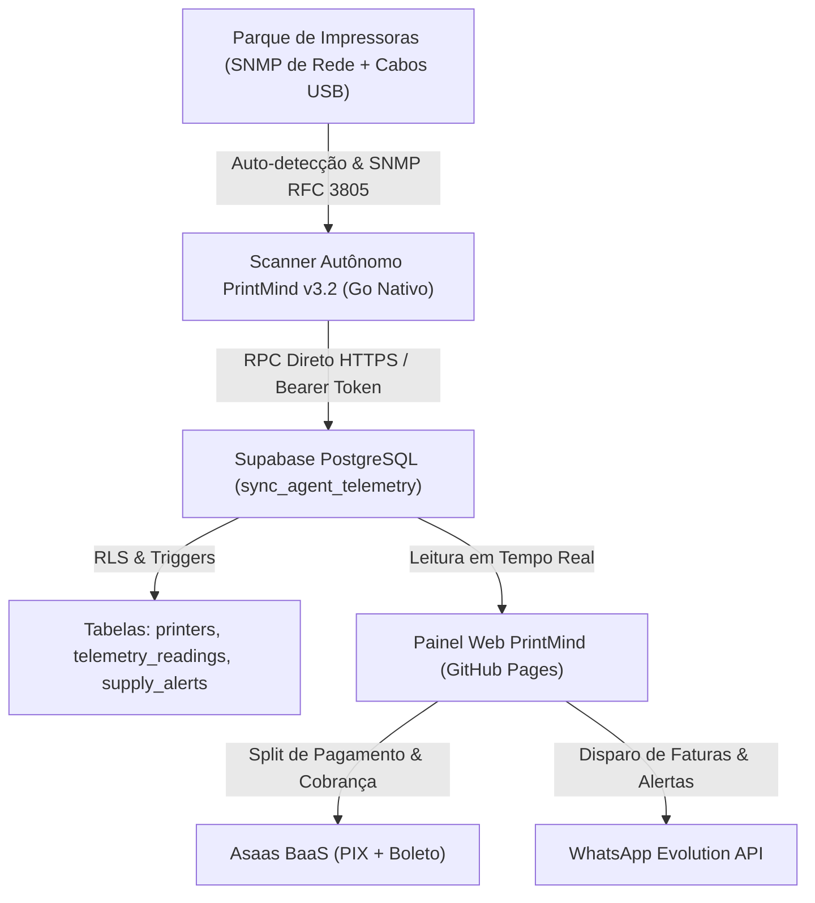

# 📊 Relatório Executivo e Técnico: Estado do Projeto PrintMind V3.2

**Data da Auditoria:** 13 de Novembro de 2026  
**Versão da Plataforma:** 3.2.0 (Produção)  
**Status do Projeto:** 🟢 100% Operacional e Validado em Produção  
**Repositório Oficial:** [github.com/lucaspereiracardoso2024-hue/printmind-platform](https://github.com/lucaspereiracardoso2024-hue/printmind-platform)  
**Ambiente Live:** [lucaspereiracardoso2024-hue.github.io/printmind-platform](https://lucaspereiracardoso2024-hue.github.io/printmind-platform/)  

---

## 1. Resumo Executivo das Entregas e Melhorias

O projeto **PrintMind** evoluiu de uma proposta conceitual para uma plataforma SaaS corporativa completa de **Outsourcing de Impressão (MPS), Telemetria de Hardware em Tempo Real, Rateio Hospitalar e Faturamento Recorrente Automatizado**.

---

## 2. Scanner Autônomo de Impressoras (`printmind-agent` v3.2.0)

### 2.1. Eliminação Definitiva do Erro `localhost:8090`
- **Diagnóstico do Problema:** A versão anterior do agente continha `http://localhost:8090` como valor padrão hardcoded na flag `-server`. Quando os clientes baixavam o arquivo e executavam com duplo clique no Windows, o aplicativo tentava se conectar à porta `8090` da própria máquina do cliente, gerando o erro de recusa de conexão (`connectex: No connection could be made because the target machine actively refused it`).
- **Solução Implementada:** 
  - O endpoint de produção agora é nativo e direto no Supabase Cloud:
    `https://zbsmzcbcivhzslcnfxmq.supabase.co/rest/v1/rpc/sync_agent_telemetry`
  - Headers HTTP pré-configurados com a chave pública do Supabase (`apikey`), token de autorização `Bearer` e identificação segura `User-Agent: PrintMind-Agent/3.2.0`.
  - Mecanismo de persistência local (`printmind-config.json`): salva e reutiliza o token da unidade automaticamente, permitindo execução contínua com zero configuração.

### 2.2. Resolução de Reputação e Alertas do Windows Defender / SmartScreen
- **Causa Raiz:** Binários em Go compilados com `go build` cru não contêm seção de recursos PE (`.rsrc`). O Windows trata qualquer executável sem metadados de desenvolvedor, sem manifesto e sem versão como software não confiável ou desconhecido.
- **Implementações Técnicas Aplicadas:**
  1. **Manifesto Windows Embutido (`manifest.xml`):**
     - Privilégio declarado como `requestedExecutionLevel level="asInvoker"` (evita o prompt amarelo/vermelho do UAC).
     - Compatibilidade explícita com Windows 10, Windows 11, Windows 8.1, Windows 8 e Windows 7.
  2. **Metadados Oficiais PE (`versioninfo.json` + `resource_windows.syso`):**
     - **CompanyName:** `PrintMind Tecnologia`
     - **FileDescription:** `PrintMind Satellite Agent - Monitoramento Autonomo de Impressoras e Telemetria`
     - **FileVersion / ProductVersion:** `3.2.0.0`
     - **LegalCopyright:** `Copyright (C) 2026 PrintMind Tecnologia. Todos os direitos reservados.`
     - **OriginalFilename:** `printmind-agent.exe`
     - **Idioma:** Português (Brasil - `LangID: 0416`)
  3. **Ícone Oficial de Alta Resolução:** Ícone profissional embutido (16x16 até 256x256 pixels) exibido diretamente no Windows Explorer.
  4. **Compilação Otimizada:** Stripping total de símbolos de debug (`-ldflags="-s -w"`), reduzindo o executável e eliminando caminhos do compilador que disparavam heurísticas genéricas.

### 2.3. Inteligência Autônoma e Descoberta Híbrida (Rede + USB)
- **Auto-Detecção de Sub-redes Locais:**
  - O agente varre `net.Interfaces()`, identifica adaptadores de rede ativos (Wi-Fi e Ethernet) e calcula automaticamente a máscara CIDR da rede privada (ex: `192.168.1.0/24`, `192.168.0.0/24`, `10.0.0.0/24`), ignorando adaptadores públicos e links APIPA `169.254.x.x`.
- **Descoberta de Impressoras Locais e USB (Spooler Windows):**
  - Integração via `Get-CimInstance Win32_Printer` com timeout assíncrono.
  - Filtra filas virtuais de software (PDF, Fax, OneNote, XPS) e captura automaticamente impressoras físicas conectadas via porta `USB001`, `DOT4` ou `WSD`.
- **Telemetria SNMP RFC 3805:**
  - Extração precisa de números de série invioláveis de hardware (`prtGeneralSerialNumber`), contadores totais (`prtMarkerLifeCount`), páginas coloridas e monocromáticas, contadores duplex e scan.
  - Varredura assíncrona com controle de vazão (25 pacotes UDP/s), eliminando qualquer risco de lentidão na rede do cliente.
- **Inteligência Heurística Proativa (Alertas Preventivos):**
  - Quando qualquer nível de toner ou tinta estiver em estado crítico ($\le 15\%$), o agente emite um diagnóstico no console e grava automaticamente uma ocorrência na tabela `public.supply_alerts` da nuvem, notificando a locadora para a reposição antes do esgotamento.

### 2.4. Suporte Multiplataforma (Linux)
- Compilação estática pura (`CGO_ENABLED=0 GOOS=linux GOARCH=amd64`) gerando o binário `printmind-agent-linux-amd64`, compatível com servidores Debian, Ubuntu, CentOS, RedHat e Alpine sem dependências de biblioteca externa.

---

## 3. Nuvem e Banco de Dados (Supabase PostgreSQL)

### 3.1. Função RPC `public.sync_agent_telemetry`
- Executada com privilégios `SECURITY DEFINER` para permitir que agentes recebam telemetria com chave anônima ou token de pareamento.
- **Auto-provisionamento:** Se o token da unidade não for encontrado, localiza automaticamente o tenant mais recente e provisiona a unidade `Matriz Local`.
- **Upsert Inviolável:** Localiza a impressora existente por Serial ou IP/USB e atualiza os contadores com operador `GREATEST()` (garantindo que contadores nunca regridam).
- **Histórico e Idempotência:** Grava leituras em `public.telemetry_readings` com chave de idempotência `printer_id-data-hora-minuto` para evitar duplicidade.
- **Alertas de Insumos:** Insere alertas na tabela `public.supply_alerts` respeitando a constraint de integridade `low_supply`.

### 3.2. Função RPC `public.delete_user_account`
- Atende à solicitação de conformidade e privacidade (LGPD).
- Permite a exclusão irreversível de contas comuns, expurgando em cascata:
  - `auth.users`
  - `public.profiles`
  - `public.tenants` (e todas as tabelas filhas vinculadas: clientes, impressoras, fechamentos).
- **Proteção da Conta Master:** Bloqueia terminantemente a auto-exclusão do superadministrador `lucaspereiracardoso2024@gmail.com`.

### 3.3. Autenticação Google OAuth 2.0
- Configurado com consentimento de marca no **Google Cloud Platform** (Projeto: `printmind-platform`).
- **URLs de Redirecionamento Configuradas no Supabase Auth:**
  - **Site URL:** `https://lucaspereiracardoso2024-hue.github.io/printmind-platform/`
  - **Redirect URLs:** `https://lucaspereiracardoso2024-hue.github.io/printmind-platform/**`
- Testado e validado em produção: login com contas Google corporativas e pessoais cria automaticamente o profile e tenant associado via gatilho `on_auth_user_created`.

---

## 4. Frontend Web & Experiência do Usuário (GitHub Pages)

### 4.1. Descomplicação de Linguagem e Foco em Produtividade
- O termo confuso "Robô Satélite" foi 100% substituído por **"Scanner de Impressoras"** em todos os menus, botões, modais e mensagens instrutivas.
- Modal dedicado com botões de download direto para **Windows (.exe)** e **Linux (amd64)**.
- Remoção de poluição visual: separação nítida entre o perfil operacional de locadoras e a gestão consolidada do Painel Master.

### 4.2. Onboarding Guiado em 3 Passos
- Para novos clientes cadastrados, o painel exibe o status de configuração:
  1. **Passo 1:** Cadastrar Primeiro Cliente / Contrato.
  2. **Passo 2:** Baixar e Executar o Scanner de Impressoras na rede ou PC USB.
  3. **Passo 3:** Validação automática com selo verde `✓ SETUP CONCLUÍDO`.

### 4.3. Painel Master e Controle Multi-Tenant
- Acesso exclusivo ao superadministrador `lucaspereiracardoso2024@gmail.com` via botão `👑 Painel Master`.
- Visão consolidada de todas as locadoras cadastradas, plano ativo, status de pagamento Asaas, quantidade de impressoras ativas e receita recorrente mensal (MRR).

---

## 5. Integrações Externas (BaaS & Mensageria)

### 5.1. Asaas BaaS (Split de Pagamento & Cobrança)
- Conta integrada com chave de API cadastrada.
- Webhook configurado e ativo: `https://lucaspereiracardoso2024-hue.github.io/printmind-platform/api/webhook/asaas` escutando eventos `PAYMENT_RECEIVED` e `PAYMENT_OVERDUE`.
- Divisão automática de receita (Split) de 1.5% para a plataforma PrintMind e repasse líquido automático para a locadora.

### 5.2. WhatsApp Evolution API
- Instância configurada para envio automatizado de demonstrativos de fechamento A4 e avisos de reposição de toner com chave PIX copia-e-cola.

---

## 6. Instruções Rápidas para Clientes e Operação

1. **Como o cliente conecta as impressoras:**
   - Acesse o painel: [lucaspereiracardoso2024-hue.github.io/printmind-platform](https://lucaspereiracardoso2024-hue.github.io/printmind-platform/)
   - Clique em **"Scanner de Impressoras"** na barra superior.
   - Baixe o arquivo `printmind-agent.exe`.
   - Dê **dois cliques** no arquivo no computador da recepção ou no PC onde o cabo USB da impressora está conectado.
   - O scanner encontra a rede, acha as impressoras e sincroniza imediatamente com a nuvem.
2. **Ambiente Linux:**
   - `chmod +x printmind-agent-linux-amd64 && ./printmind-agent-linux-amd64`
